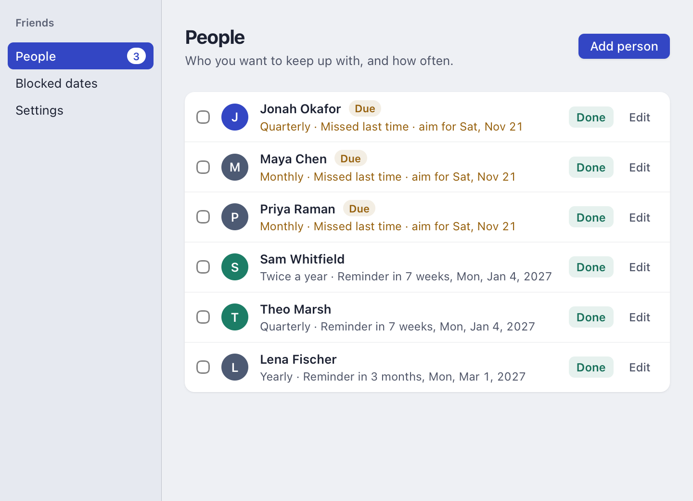

# Friends

A small macOS menu bar app that reminds you to stay in touch with people.

Add the people you want to see, say how often (every month, three months, six months or
year), and Friends picks a day to aim for and reminds you before it. It skips the dates you've
blocked (trips, busy weeks), can aim only for weekends or only for weekdays, and if a day goes
by without you reaching out, it moves the reminder to the next good day.

Everything stays on your Mac: no account, no sync, no tracking.

<p>
  
  
</p>
<p>
  
</p>

The people in these screenshots are made up.

## Install

1. Download `Friends_<version>_universal.dmg` from the
   [latest release](https://github.com/charliespy/networking-reminder/releases/latest).
2. Open it and drag **Friends** to **Applications**.
3. Friends isn't signed with an Apple Developer ID yet, so macOS stops the first launch with
   "Apple could not verify Friends is free of malware". To open it anyway:
   - open **Friends** once and click **Done**;
   - go to **System Settings → Privacy & Security**, scroll down, and click **Open Anyway**
     next to the Friends message;
   - confirm with your password.

   Or, in Terminal: `xattr -dr com.apple.quarantine /Applications/Friends.app`.
4. Friends appears in the menu bar. Click it to see who's due; open **Preferences** to add
   people.

Requires macOS 13 (Ventura) or newer.

## Build from source

You need [Node.js](https://nodejs.org/) 22+ and [Rust](https://rustup.rs/).

```sh
npm install
npm run tauri dev        # run the app
npm run tauri build      # build Friends.app and a .dmg into target/release/bundle/
```

## Test

```sh
npm run check            # types, lint, unit tests, Rust checks
npm run e2e              # end-to-end tests (Playwright, WebKit)
```

## How the reminders work

- Each person has a frequency. The next day to aim for is their last contact plus that many
  days, moved forward past blocked dates and to an allowed day.
- With **weekends only**, the reminder comes on the Monday before the weekend, so there's time
  to plan. Otherwise it comes on the day itself.
- Mark someone **Done** from the menu bar when you've been in touch; their next day is
  scheduled from today.
- If the day passes without **Done**, Friends keeps them in the list and aims for the next
  allowed day.

## Contributing

See [CONTRIBUTING.md](CONTRIBUTING.md). Please report security problems privately, as
[SECURITY.md](SECURITY.md) explains.

## License

[MIT](LICENSE)
