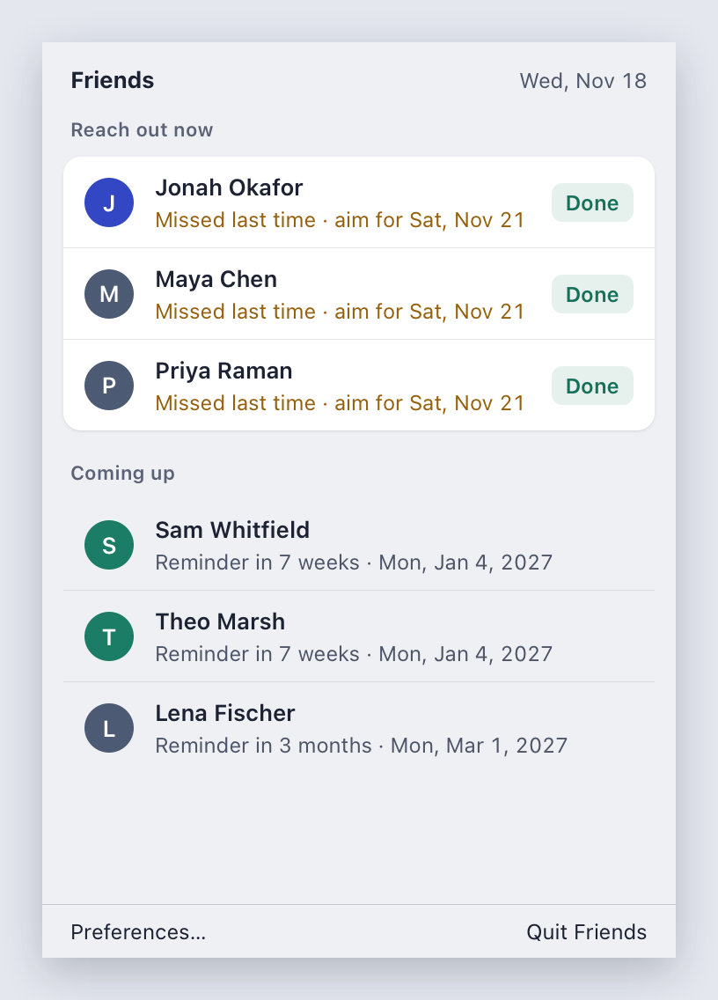
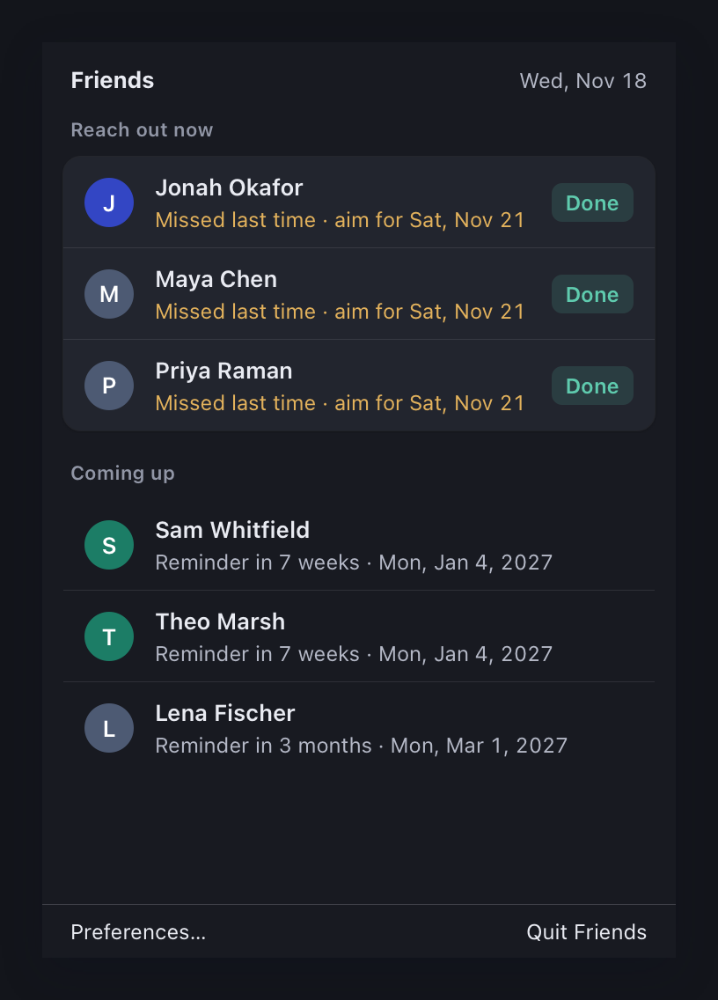

# Friends

A small macOS menu bar app that reminds you to stay in touch with people.

Add the people you want to see, say how often (every month, three months, six months or
year), and Friends picks a day to aim for and reminds you before it. It skips the dates you've
blocked (trips, busy weeks), can aim only for weekends or only for weekdays, and if a day to
aim for goes by without you reaching out, it keeps them on your list and aims for the next good
days.

Everything stays on your Mac, with no tracking. You can sign in with Apple to set up a Friends
account, ready for a Friends app on iPhone; nothing syncs yet.

<p>
  
  
</p>
<p>
  
</p>

The people in these screenshots are made up.

## Install

1. Download `Friends_<version>_universal.dmg` from the
   [latest release](https://github.com/charliespy/friendship-reminder/releases/latest).
2. Open it and drag **Friends** to **Applications**.
3. Open **Friends**. It is signed with an Apple Developer ID and notarized by Apple, so macOS
   only asks once whether you want to open an app downloaded from the internet. (Versions before
   0.1.2 weren't: macOS blocks their first launch until you click **Open Anyway** in
   **System Settings → Privacy & Security**.)
4. Friends appears in the menu bar. Click it to see who's due; open **Preferences** to add
   people.

Requires macOS 13 (Ventura) or newer.

## Build from source

You need [Node.js](https://nodejs.org/) 22+ and [Rust](https://rustup.rs/).

```sh
npm install
npm run tauri dev        # run the app
npm run tauri build      # build Friends.app and a .dmg into target/release/bundle/
```

### Sign in with Apple

Signing in happens in the browser: Friends opens Sign in with Apple there, and the browser comes
back to Friends at `http://127.0.0.1:<port>/auth/callback` when it's done. (Apple's own sign-in
sheet only works in Mac App Store apps.) A build offers it only when it has the account server's
settings, `FRIENDS_SUPABASE_URL` and `FRIENDS_SUPABASE_PUBLISHABLE_KEY`, at build time; otherwise
the Account section in Settings says sign-in isn't available, and everything else works the same.
Set them in the environment or in `.env.local` at the repo root, which git ignores:

```sh
FRIENDS_SUPABASE_URL=https://<project>.supabase.co
FRIENDS_SUPABASE_PUBLISHABLE_KEY=sb_publishable_...
```

The Supabase project needs the Apple provider on (with a Services ID and its secret key) and
`http://127.0.0.1:*/auth/callback` in its allowed redirect URLs.

## Test

```sh
npm run check            # types, lint, unit tests, Rust checks
npm run e2e              # end-to-end tests (Playwright, WebKit)
```

Every PR runs these on GitHub, plus a privacy scan and a check that the title is a conventional
commit. They all have to pass before anything reaches `main`; CONTRIBUTING.md explains how.

## How the reminders work

- Each person has a frequency. The next day to aim for is their last contact plus that many
  days, moved forward past blocked dates and to an allowed day.
- When the day to aim for is a Saturday or Sunday, the reminder comes on the Monday before, so
  there's time to plan. A weekday is reminded on the day itself.
- Mark someone **Done** from the menu bar when you've been in touch; their next day is
  scheduled from today.
- If the day passes without **Done**, Friends keeps them in the list. It counts the day as
  missed only once the rest of that weekend (under weekends only) or that week (under weekdays
  only) is over too; with every day allowed, just that day. Then it aims for the next run of
  allowed days, past any blocked dates.

## Contributing

See [CONTRIBUTING.md](CONTRIBUTING.md). Please report security problems privately, as
[SECURITY.md](SECURITY.md) explains.

## License

[MIT](LICENSE)
